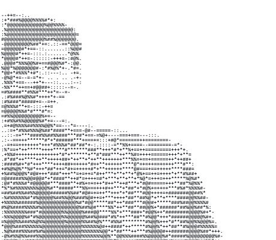

<!-- ASCII portrait generated from GitHub profile picture -->

## Sutharsan

**Full Stack Developer · AI Builder · Creative Coder**

 

### 🛠️ Tech Stack

**Languages:** JavaScript/TypeScript, Python, Go, Bash  
**Frontend:** React, Next.js, Tailwind CSS  
**Backend:** Node.js, Express, Claude Agent SDK  
**AI/ML:** Claude API, LLM Integration, Agent Development  
**Tools & Platforms:** Docker, Git, Linux, Vercel

 

### 📌 Featured Projects

- **[Personal AI Assistant](https://github.com/sutharsan-311/assistant)** — WhatsApp-connected AI using Claude Agent SDK
- **[Portfolio](https://sutharsan.is-a.dev)** — Fullstack projects and case studies

 

**Let's build something amazing together** 🚀

