<a href="https://sutharsan.is-a.dev/?src=github"></a>

<div align="center">

[](https://sutharsan.is-a.dev/?src=github)
[](https://linkedin.com/in/sutharsan311?src=github)
[](mailto:sutharsanmail311@gmail.com)


</div>

```
> whoami
```

**Sutharsan K.** Robotics engineer at **Spotless AI**. Spends the day teaching robots to find their way through hospitals with LiDAR and a lot of patience.

Got tired of restarting Nav2 just to change one number, so built [a tool](https://github.com/sutharsan-311/nav2_config) that changes it while the robot is still driving. 

Thought left-to-right was a strange way for a language model to write, so [trained one from scratch](https://github.com/sutharsan-311/tiny-dllm) that starts from a blank page and un-masks the words instead.

Spent weeks trying to make one vision encoder do the work of two on a Jetson. [It failed.](https://github.com/sutharsan-311/unified-perception) Published the failure anyway, then sent it to NVIDIA.

Also made [Spotify Wrapped for git commits](https://github.com/sutharsan-311/git-recap), and taught Claude Code to [run sudo without ever seeing the password](https://github.com/sutharsan-311/claude-sudo).

Three of the nodes in that map up there are still unlabelled. Some of them are being worked on right now.
