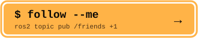

<div align="center">

<a href="https://github.com/sutharsan-311"></a>
<a href="https://sutharsan.is-a.dev"></a>

</div>

<div align="center">

[](https://sutharsan.is-a.dev)
[](https://linkedin.com/in/sutharsan311)
[](mailto:sutharsanmail311@gmail.com)


</div>

```
> whoami
```

**Sutharsan K** is a robotics engineer at **Spotless AI**, building autonomous robots that navigate hospitals. The work sits where navigation, perception and real hardware meet, and most of it happens after the robot leaves simulation, which is where robots discover that glass doors exist.

Sutharsan wrote [**nav2_config**](https://github.com/sutharsan-311/nav2_config), a live tuning GUI for Nav2 that lets you change navigation parameters on a running robot without a relaunch, and [**samowl**](https://github.com/sutharsan-311/samowl), an open-vocabulary 3D object detection and scene graph system for ROS2. Type "find the red chair" and the robot goes looking for it.

```
> ros2 node list --verbose
```

| node | what runs there |
|:--|:--|
| `/navigation` | Nav2 tuning, costmaps, controllers and lifecycle management on real robots |
| `/perception` | LiDAR and RGB-D pipelines, open-vocabulary detection and segmentation with OWLv2 and SAM |
| `/edge_ai` | Fitting models onto a Jetson Orin NX with TensorRT, and measuring what it actually costs |
| `/hardware` | Bringing up drivers and controllers with ros2_control |

```
> ros2 pkg list --stack
```

<p>


</p>

```
> ros2 topic echo /field_notes
```

```yaml
data: "a robot that works in simulation is a hypothesis"
---
data: "inflation_radius is never right the first time"
---
data: "if it can go wrong on a real floor, it will, during the demo"
---
```

```
> ros2 service call /follow std_srvs/Trigger
```

<details>
<summary><b>⚠️ do not expand. this is a robot's personal space.</b></summary>
<br/>

```yaml
success: false
message: "follow request pending. human approval required."
hint: "press Follow at the top of github.com/sutharsan-311, then check sutharsan.is-a.dev for the robots"
```

You opened it anyway. That is exactly the curiosity robotics needs. [Go see the portfolio →](https://sutharsan.is-a.dev)

</details>

<br/>

<div align="center">

**Robots follow paths. Humans follow people who build robots.**

<a href="https://github.com/sutharsan-311"></a>
<a href="https://sutharsan.is-a.dev"></a>

<a href="https://github.com/sutharsan-311"></a>

</div>
