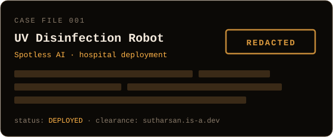
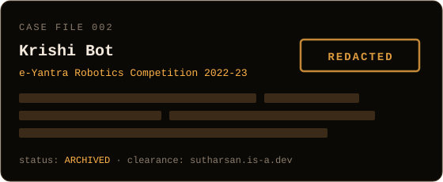

<a href="https://sutharsan.is-a.dev"></a>

<div align="center">

[](https://sutharsan.is-a.dev)
[](https://linkedin.com/in/sutharsan311)
[](mailto:sutharsanmail311@gmail.com)


</div>

```
> whoami
```

**Sutharsan K** is a robotics engineer at **Spotless AI**, building autonomous robots that navigate hospitals. The work sits where navigation, perception and real hardware meet, and most of it happens after the robot leaves simulation, which is where robots discover that glass doors exist.

Sutharsan wrote [**nav2_config**](https://github.com/sutharsan-311/nav2_config) , the live Nav2 tuning GUI that roboticists use to change navigation parameters on a running robot without a relaunch, and [**samowl**](https://github.com/sutharsan-311/samowl), an open-vocabulary 3D object detection and scene graph system for ROS2. Type "find the red chair" and the robot goes looking for it.

```
> ros2 node list --verbose
```

| node | what runs there |
|:--|:--|
| `/navigation` | Nav2 tuning, costmaps, controllers and lifecycle management on real robots |
| `/perception` | LiDAR and RGB-D pipelines, open-vocabulary detection and segmentation with OWLv2 and SAM |
| `/edge_ai` | Fitting models onto a Jetson Orin NX with TensorRT, and measuring what it actually costs |
| `/hardware` | Bringing up drivers and controllers with ros2_control |

```
> ls case_files/
```

<p align="center">
<a href="https://sutharsan.is-a.dev"></a>
<a href="https://sutharsan.is-a.dev"></a>
</p>

```
> ros2 topic echo /field_notes
```

```yaml
data: "a robot that works in simulation is a hypothesis"
---
data: "tune inflation_radius and cost_scaling_factor together. a soft gradient keeps the robot centred in corridors instead of hugging walls"
---
data: "before blaming the controller, check TF. a stale transform looks exactly like bad tuning"
---
data: "benchmark on the Jetson, not the laptop. the laptop always lies"
---
# waiting for next message...
```

```
> ros2 pkg list --stack
```

<p>


</p>

<details>
<summary><code>> cat /etc/classified</code></summary>
<br/>

```
Permission denied. clearance level: visitor
```

</details>

<a href="https://sutharsan.is-a.dev"></a>
